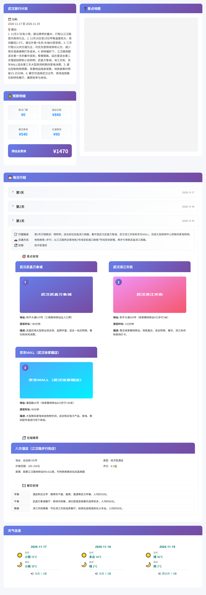

# Smart Trip Planner · 智能旅行助手

> 基于多智能体与 MCP 的 AI 旅行规划应用：输入目的地、日期与偏好，自动生成包含景点、天气、酒店、预算和地图路线的完整行程。


## 界面预览



## 简介

Smart Trip Planner 是一个前后端分离的旅行规划应用。后端用 4 个职责单一的 Agent 完成景点、天气、酒店检索与行程整合，通过 MCP（Model Context Protocol）接入高德地图能力；前端用 Vue 3 展示每日行程、预算明细和地图路线，支持在线编辑与 PDF/图片导出。

核心目标不是“让模型写一段攻略”，而是把一次多步骤任务做成**可执行、可校验、可兜底**的链路：

- Agent 自主选择工具，而不是把 API 调用写死在代码里；
- LLM 的输出经过结构化约束与 Pydantic 校验；
- 任一步失败都有降级路径，接口不会因为模型“抽风”而 500。

## 功能特性

- **多智能体协作**：景点搜索、天气查询、酒店推荐、行程规划四个 Agent 分工执行
- **MCP 工具接入**：通过 `amap-mcp-server` 接入高德地图，`auto_expand` 将 1 个 MCP 入口展开为 16 个工具
- **结构化行程**：输出包含每日景点、三餐、酒店、天气、预算的 JSON，并由 Pydantic 校验
- **地图可视化**：高德 JSAPI 绘制编号 Marker、信息窗口与游览路线
- **行程编辑**：支持景点上移/下移/删除，保存后地图同步刷新
- **导出**：一键导出 PNG 图片或 A4 PDF
- **图片补全**：通过 Unsplash 为景点自动配图

## 系统架构

```
┌──────────────────────────────────────────────────────┐
│  Frontend: Vue 3 + TypeScript + Vite + Ant Design    │
│  Home 表单  ·  Result 展示  ·  AMap 地图  ·  导出     │
└──────────────────────────┬───────────────────────────┘
                           │ HTTP / JSON (axios)
┌──────────────────────────▼───────────────────────────┐
│  Backend: FastAPI + Pydantic                         │
│  路由 / 参数校验 / CORS / 配置管理                     │
└──────────────────────────┬───────────────────────────┘
                           │ 函数调用
┌──────────────────────────▼───────────────────────────┐
│  Agent Layer: HelloAgents                            │
│  4 × SimpleAgent + 1 × shared MCPTool                │
└──────────────────────────┬───────────────────────────┘
                           │ stdio / JSON-RPC
┌──────────────────────────▼───────────────────────────┐
│  External: amap-mcp-server → 高德地图 API             │
│            Unsplash API（景点图片）                    │
└──────────────────────────────────────────────────────┘
```

一次请求的流程：

1. 前端表单校验后 `POST /api/trip/plan`；
2. FastAPI 用 `TripRequest` 校验参数；
3. 景点 Agent → 天气 Agent → 酒店 Agent 依次调用 MCP 工具；
4. 三路结果 + 用户约束交给规划 Agent，生成结构化 JSON；
5. 解析 JSON → `TripPlan` 校验 → 失败则返回兜底行程；
6. 前端渲染概览、预算、地图、每日行程。

## 技术栈

| 层 | 技术 |
|---|---|
| 后端 | Python 3.10+、FastAPI、Pydantic v2、Uvicorn |
| Agent | HelloAgents（SimpleAgent、MCPTool） |
| 工具协议 | MCP（`amap-mcp-server`，stdio / JSON-RPC） |
| 前端 | Vue 3、TypeScript、Vite、Ant Design Vue、Axios |
| 地图 | 高德地图 JavaScript API 2.0 |
| 导出 | html2canvas、jsPDF |
| 图片 | Unsplash API |

## 项目结构

```
smart-trip-planner/
├── backend/
│   ├── app/
│   │   ├── agents/
│   │   │   └── trip_planner_agent.py   # 4 Agent 编排、JSON 解析、兜底
│   │   ├── api/
│   │   │   ├── main.py                 # FastAPI 入口、CORS、lifespan
│   │   │   └── routes/
│   │   │       ├── trip.py             # 行程生成
│   │   │       └── poi.py              # 景点图片
│   │   ├── models/
│   │   │   └── schemas.py              # Pydantic 请求/响应模型
│   │   ├── services/
│   │   │   ├── llm_service.py          # LLM 单例
│   │   │   └── unsplash_service.py     # Unsplash 封装
│   │   └── config.py                   # pydantic-settings 配置
│   ├── requirements.txt
│   ├── run.py
│   └── .env.example
├── frontend/
│   ├── public/favicon.svg
│   ├── src/
│   │   ├── views/Home.vue              # 表单与提交
│   │   ├── views/Result.vue            # 地图、预算、编辑、导出
│   │   ├── services/api.ts             # Axios 封装
│   │   ├── types/index.ts              # TypeScript 类型
│   │   ├── App.vue
│   │   └── main.ts
│   ├── index.html
│   ├── package.json
│   ├── tsconfig.json
│   ├── vite.config.ts
│   └── .env.example
├── .editorconfig
├── .gitignore
├── LICENSE
├── NOTICE
└── README.md
```

## 快速开始

### 前置条件

- Python 3.10+
- Node.js 18+
- 高德地图 **Web 服务 Key**（后端 MCP 使用）
- 高德地图 **Web 端（JS API）Key**（前端地图使用）
- 任意 OpenAI 兼容的 LLM API
- `amap-mcp-server`（随依赖单独安装，见下方命令）

### 1. 启动后端

```bash
cd backend
python -m venv .venv

# Windows
.venv\Scripts\activate
# macOS / Linux
source .venv/bin/activate

pip install -r requirements.txt
# amap-mcp-server 固定依赖 mcp==1.8.1，会与 fastmcp 2.14 的 mcp 1.30 冲突，
# 必须用 --no-deps 安装，让服务端复用当前环境的新版 mcp
pip install --no-deps amap-mcp-server==0.1.11
cp .env.example .env        # Windows: copy .env.example .env
# 编辑 .env，填入 LLM 与高德配置
python run.py
```

后端启动后：

- API 文档：<http://localhost:8000/docs>
- 健康检查：<http://localhost:8000/health>

### 2. 启动前端

```bash
cd frontend
npm install
cp .env.example .env        # Windows: copy .env.example .env
# 编辑 .env，填入 VITE_AMAP_WEB_JS_KEY
npm run dev
```

访问 <http://localhost:5173>。

## 环境变量

### backend/.env

| 变量 | 必填 | 说明 |
|---|---|---|
| `LLM_MODEL_ID` | 是 | 模型名，如 `deepseek-chat` |
| `LLM_API_KEY` | 是 | LLM API Key |
| `LLM_BASE_URL` | 是 | OpenAI 兼容接口地址 |
| `LLM_TIMEOUT` | 否 | 请求超时（秒），默认 60 |
| `AMAP_API_KEY` | 是 | 高德 **Web 服务** Key |
| `UNSPLASH_ACCESS_KEY` | 否 | 景点配图；不填则使用占位图 |
| `HOST` / `PORT` | 否 | 服务监听地址，默认 `0.0.0.0:8000` |
| `CORS_ORIGINS` | 否 | 允许的前端来源，逗号分隔 |
| `LOG_LEVEL` | 否 | 日志级别，默认 `INFO` |

### frontend/.env

| 变量 | 必填 | 说明 |
|---|---|---|
| `VITE_API_BASE_URL` | 否 | 后端地址，默认 `http://localhost:8000` |
| `VITE_AMAP_WEB_JS_KEY` | 是 | 高德 **Web 端（JS API）** Key |

> 高德需要申请两个不同类型的 Key：后端 MCP 用“Web 服务”，前端地图用“Web 端（JS API）”，不能混用。

## API

| 方法 | 路径 | 说明 |
|---|---|---|
| `POST` | `/api/trip/plan` | 生成旅行计划 |
| `GET` | `/api/trip/health` | 行程服务健康检查 |
| `GET` | `/api/poi/photo?name=故宫` | 获取景点图片 |
| `GET` | `/health` | 应用健康检查 |
| `GET` | `/docs` | Swagger UI |

请求示例：

```bash
curl -X POST http://localhost:8000/api/trip/plan \
  -H "Content-Type: application/json" \
  -d '{
    "city": "北京",
    "start_date": "2026-06-01",
    "end_date": "2026-06-03",
    "travel_days": 3,
    "transportation": "公共交通",
    "accommodation": "经济型酒店",
    "preferences": ["历史文化", "美食"],
    "free_text_input": "希望多安排一些博物馆"
  }'
```

## 实现要点

1. **多 Agent 拆分**：单个 SimpleAgent 一次 `run()` 只能执行一个工具，多轮 ReAct 又会增加 LLM 调用与延迟；按“检索—整合”拆成 4 个职责单一的 Agent，Prompt 更短、失败更易定位。
2. **MCP 工具展开**：`MCPTool(auto_expand=True)` 在启动时调用 `tools/list`，为每个远程工具生成本地 wrapper，Agent 看到的是 16 个独立工具；三个检索 Agent 共享同一个 MCP 实例，只保留一个 server 进程。
3. **输出约束与容错**：Prompt 固定 JSON Schema；解析兼容 ```json 代码块、裸代码块、首尾大括号三种形态；Pydantic 校验字段与类型（含温度单位清洗）；失败时返回兜底行程。
4. **前端交互**：表单用 dayjs 自动计算天数；地图用 Marker + InfoWindow + Polyline + `setFitView`；编辑模式深拷贝原计划，支持增删排序；导出用 html2canvas + jsPDF。

## 已知限制

- 进度条为前端模拟，不是后端真实进度；后续可改 SSE。
- 四个 Agent 串行执行，端到端约 10–30s；可将三个检索并行化。
- 兜底行程为占位数据，仅保证接口可用，不代表真实规划结果。
- 未实现鉴权、持久化、限流与自动化测试。
- POI/天气/路线等独立 HTTP 接口未包含在本仓库中；这些能力目前通过 Agent → MCP 链路使用。

## Roadmap

- [ ] 三个检索 Agent 并行化（`asyncio.gather`）
- [ ] SSE 推送真实生成进度
- [ ] 预算由后端按明细重算，避免 LLM 加总错误
- [ ] 增加 20 条固定需求的回归评测（成功率、耗时、解析失败率）
- [ ] Docker Compose 一键启动
- [ ] 单元测试与 GitHub Actions CI

## 致谢

本项目基于 Datawhale 开源教程 [Hello-Agents](https://github.com/datawhalechina/Hello-Agents) 第 13 章示例整理与重构，感谢原作者与社区。

## License

[CC BY-NC-SA 4.0](LICENSE) © 2025 Smart Trip Planner contributors

本作品仅限非商业用途；转载或二次开发需保留署名，并以相同协议共享。
